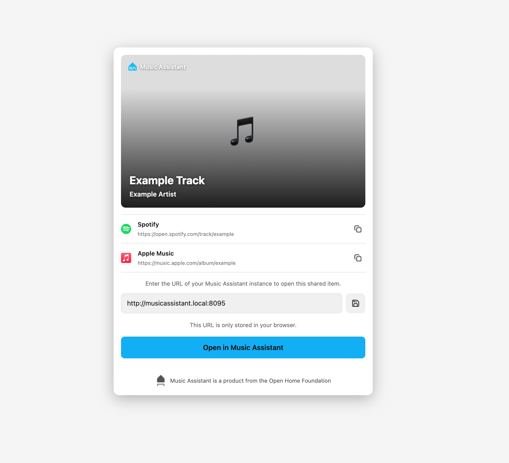

# share.music-assistant.io

Landing page for Music Assistant share links. It shows the shared track, album or artist with links to the streaming services, and opens it in the recipient's own Music Assistant instance. The page is static and makes no requests to any Music Assistant server.

Originally written by [@dmoo500](https://github.com/dmoo500) as [music-assistant-share](https://github.com/dmoo500/music-assistant-share).



## Link format

- A link is `https://share.music-assistant.io/#<payload>`, so the payload is never sent to this site.
- `<payload>` is the format version `1` followed by base64url (no padding) of raw-deflated compact JSON.
- The JSON is the server's `SharePayload` (`music_assistant/providers/share_provider/payload.py`); both the encoded and decompressed payload are capped at 64 KiB.

## Development

```bash
npm ci && npm run dev
```

`npm test` runs the decoder and share-page component tests, and `npm run lint`
checks ESLint and Prettier.

## Deployment

Every push to `main` is built and published to GitHub Pages automatically.
